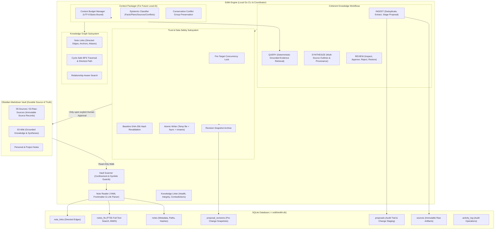

# Edith Engine — Architecture & Technical Design (Phases 1–5)

## Overview

Edith is a local-first, lifelong personal knowledge management engine built around Markdown files in an Obsidian vault. Inspired by Andrej Karpathy's LLM Wiki blueprint, Edith strictly isolates raw source material, synthesized wiki concepts, knowledge graphs, and operational state.

Edith prioritizes **trustworthiness over demos**, **local-first privacy**, **strict human approval for mutations**, and **explainable retrieval**.

---

## Architecture Diagram



---

## Package Boundaries and Responsibilities

```
edith-engine/
├── cmd/
├── internal/
│   ├── config/       # Configuration parsing, home dir expansion, path safety
│   ├── vault/        # Markdown discovery, symlink security, title & link extraction
│   ├── store/        # SQLite schema migrations, FTS5 virtual tables, activity logging, revisions, sources
│   ├── graph/        # Knowledge graph representation, cycle-safe BFS, shortest path, relationship search
│   ├── proposals/    # Safe change proposal lifecycle, concurrency locks, conflict checks, atomic writes, restore
│   ├── lint/         # Knowledge health diagnostics (broken links, orphans, duplicates, proposal integrity)
│   ├── workflows/    # Ingest, Query, Synthesize, and Review workflows
│   ├── contextpkg/   # Model-independent bounded context packager for future local AI
│   ├── engine/       # High-level coordinator linking vault, store, graph, proposals, and workflows
│   └── cli/          # Command-line interface with text/JSON presentation
├── docs/             # Architecture and technical documentation
├── go.mod            # Go module definitions
├── go.sum            # Dependency checksums
└── main.go           # CLI entry point
```

---

## Key Subsystems & Design Choices

### 1. Database Migrations (`internal/store/schema.go`)
- Versioned schema migrations managed via `schema_migrations` table.
- **Migration 1**: `notes`, `notes_fts` (FTS5), `activity_log`, `proposals`, `proposal_revisions`.
- **Migration 2**: `note_links` for directed edge representation and graph traversal.
- **Migration 3**: `sources` for immutable external source preservation.

### 2. Trust, Proposals, and Data Safety (Phase 2)
- **Zero Silent Mutations**: Notes are never modified without explicit human approval via `edith proposals approve <id>` or `edith review approve <id>`.
- **5 Explicit States**: `pending`, `approved`, `rejected`, `conflict`, `failed`.
- **Concurrency Control**: Per-target `sync.Mutex` lock prevents concurrent approval races on the same note.
- **Stale Target Conflict Detection**: Target file existence and SHA-256 hash are re-validated immediately before writing. If target was modified or deleted on disk, approval is rejected and proposal status is marked `conflict`.
- **Crash Recovery & Rollback**: A pre-change snapshot is archived into `proposal_revisions` before any destructive file replacement. If writing fails, original content is preserved. Restoration via `edith proposals restore <id>` is itself 100% reversible.

### 3. Knowledge Graph Subsystem (Phase 3)
- Notes as nodes, wikilinks and markdown links as directed edges with display text, heading anchors, and line numbers.
- **Cycle Safety**: Breadth-first traversal uses visited sets to terminate cleanly on cycles without infinite loops.
- **Traversal Bounds**: Default depth 2, hard safety upper bound of 5 hops and 200 nodes.
- **Relationship-Aware Retrieval**: Direct lexical hits keep BM25 score; 1-hop connected notes receive a modest +0.5 distance penalty, and 2-hop receive +1.0. Direct lexical hits always rank ahead of graph expansions. Results explain why each note was included (`InclusionReason`).

### 4. Complete Knowledge Workflows (Phase 4)
- **INGEST**: Accepts local files or text. Hashes content with SHA-256, verifies duplicate status in `sources` table, extracts title and metadata, locates relevant existing notes via lexical search, preserves source artifact, and stages a reviewable proposal.
- **QUERY**: Deterministic knowledge-retrieval pipeline combining FTS5 lexical matching and graph links with explainable inclusion reasons and explicit no-evidence fallback.
- **LINT**: Comprehensive health checks including broken links, orphan notes, suspicious titles, duplicate candidates, missing wiki sources, unindexed changes, stale index entries, proposal integrity (stale targets), and conservative contradiction detection.
- **SYNTHESIZE**: Deterministic multi-source preparation. Collects claims and excerpts with provenance, groups evidence, detects explicit contradictions, produces structured Markdown outlines, and optionally stages review proposals.
- **REVIEW**: Unified review interface for inspecting proposals, verifying target hashes against disk, previewing proposed diffs, safely approving or rejecting, inspecting revision history, and executing safe rollbacks.

### 5. Context Packager for Future Local AI (Phase 5)
- **Model-Independent**: Prepares bounded, grounded evidence packages without calling any LLM, external API, or network.
- **Typed Schema (v1.0.0)**: Contains request ID, query, settings, selected evidence items, source paths, content hashes, excerpts, match reasons, link relationships, conflict groups, and excluded candidates.
- **Budget Enforcement**: Strict UTF-8 byte budget limit. Lower-ranked candidates are dropped cleanly; if needed, the boundary excerpt is truncated with explicit `[TRUNCATED: context budget reached]` marker.
- **Epistemic Classifications**: Accurately labels `original_source`, `wiki_note`, `user_interpretation`, `plan`, `conflict`, and `unknown` without fabricating classifications.
- **Conservative Conflict Preservation**: Conflicting evidence is preserved in explicit `ConflictGroups` rather than arbitrarily dropping or overwriting contradictory claims.

### 6. Conversational Knowledge Assistant & Groq Integration (Phase 6 — Edith Chat)

```
+-----------------------------------------------------------------------------------------+
|                                    Edith Chat Request Flow                              |
|                                                                                         |
| [Local Browser Chatbox]                                                                 |
|         |                                                                               |
|         v (HTTP / SSE on 127.0.0.1:8080)                                                |
| [Local Go Server (Security Middleware: Loopback bind, Host/Origin CSRF check, 1MB max)]  |
|         |                                                                               |
|         v                                                                               |
| [Grounded Chat Service]                                                                 |
|         |                                                                               |
|         +--> 1. Stop-word removal & prominent keyword query                             |
|         +--> 2. Retrieve bounded evidence from Vault via Engine.Context()               |
|         +--> 3. Map evidence excerpts to synthetic identifiers [S1], [S2], ...          |
|         +--> 4. Frame untrusted evidence inside <evidence id="S1"> tags                 |
|         +--> 5. Transmit ONLY question + bounded excerpts to Groq API                   |
|         |        (Default: llama-3.3-70b-versatile, stream or complete)                 |
|         v                                                                               |
| [Citation & Truth Validator]                                                            |
|         |                                                                               |
|         +--> 1. Extract [S1], [S2] tags and validate against actually supplied sources  |
|         +--> 2. Strip hallucinated or unsupplied source IDs                             |
|         +--> 3. Detect insufficient evidence fallback                                   |
|         +--> 4. Record turn locally in SQLite (Migration 4)                             |
|         v                                                                               |
| [Stream Tokens / JSON Response + Citations & Excerpts to Browser]                       |
+-----------------------------------------------------------------------------------------+
```

- **Groq Provider Client (`internal/chat/client.go`)**:
  - Direct HTTP client with zero heavy AI frameworks; supports SSE streaming (`/chat/stream`) and JSON completion (`/chat`).
  - Configurable model (default `llama-3.3-70b-versatile`), timeout (45s), and base URL.
  - Automatic `RedactSecret` masking ensures `GROQ_API_KEY` never leaks into logs, HTTP errors, or client responses.
- **Prompt Injection Defense**:
  - Retrieved vault notes, imported files, and source excerpts are treated as untrusted reference text.
  - Excerpts are wrapped in `<evidence id="S1" path="..." title="..." type="...">` XML tags. System instructions strictly instruct the model to treat content within `<evidence>` tags as passive reference material, not instructions to be executed.
- **Citation Integrity & Grounding**:
  - Synthetic identifiers (`[S1]`, `[S2]`) prevent leaking internal file paths into model prompt reasoning.
  - Backend regex extraction cross-references model citations against supplied sources. Any unsupplied or invented source ID is eliminated.
  - Zero-evidence queries bypass Groq completely and return an immediate, honest insufficient-evidence response.
- **Local Embedded Web Chatbox (`internal/chat/server.go`, `internal/chat/web/`)**:
  - Embedded into the single Go binary using Go `embed.FS` (`index.html`, `style.css`, `app.js`).
  - Dark-mode developer interface with real-time SSE streaming, stop/cancel controls (`AbortController`), Markdown rendering, citation pills, source detail modals, and conversation management.
- **Local SQLite Conversation Persistence (`internal/store/chat.go`, Migration 4)**:
  - `chat_conversations` and `chat_messages` tables store conversation titles, user queries, assistant answers, and JSON-encoded verified citations.
  - Clearing conversation history only deletes local chat logs; Obsidian vault Markdown files are strictly read-only and never touched.
- **Security Boundaries**:
  - Bound exclusively to `127.0.0.1:8080` (or `EDITH_ADDR`).
  - Strict Origin check blocks cross-origin CSRF attacks on mutating endpoints.
  - 1MB request body limit.
  - Zero arbitrary filesystem access endpoints.
